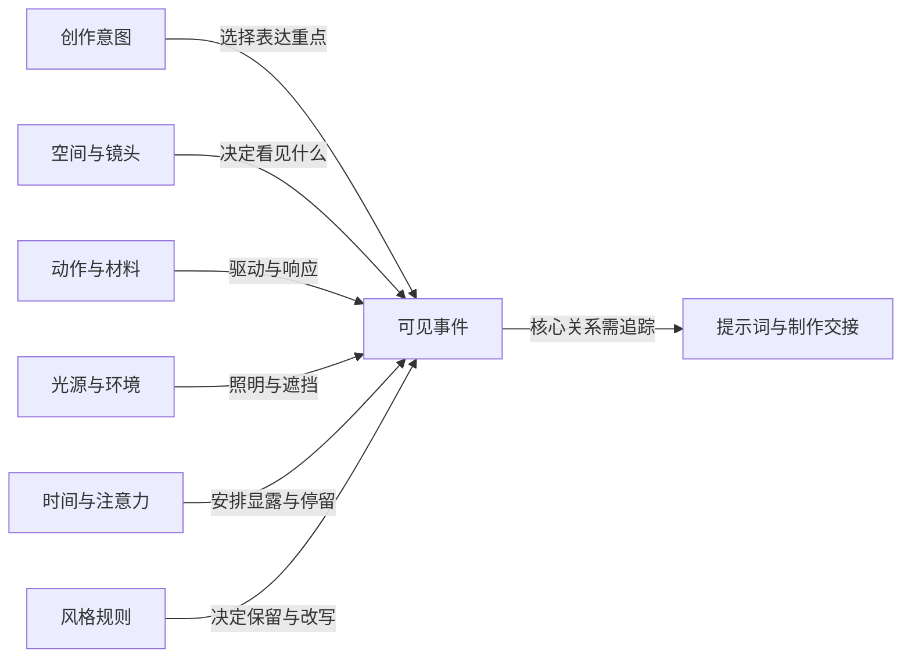

# 跨域关系与设计原则 v0.1

日期：2026-10-10 · 性质：阶段 1 的项目推导 D。依据来自[专业模块](知识体系导读.md)和[来源登记](来源登记.md)；这些原则尚未成为通过对照测试的系统规则。

## 1. 关系为什么比技巧列表更重要

“头发飘动、光影丰富、构图优美、镜头有节奏”分别提到四个领域，却没有表达它们如何共同支持作品。一项关系应说明参与对象、变化条件、可见结果与表达作用。

例如“人物走出树影时，眼部第一次获得清晰受光，但她的视线仍留在画外”同时建立运动、光影、信息显露和表演关系。它是候选设计，不能在缺少空间/光源条件时自动套用。

图是知识关系的示意，不要求每个任务调用所有节点；“注意力”与“艺术意图”也不意味着能保证观众获得相同感受。

## 2. 十六项设计原则

| 编号 | 原则 | 条件与反向检查 |
|---|---|---|
| P01 | 把意图落实为可观察变化、稳定关系或有意隐藏 | 非叙事与纯形式作品允许没有故事，但形式目标仍应具体 |
| P02 | 从场景关系选择知识，保留主动省略的可能 | 若用户要技术展示，可以显式列知识；不把省略当作永远更好 |
| P03 | 分开用户要求、助手创作假设与实现推测 | 假设能补足简单输入，但不能暗中替换动作/情绪目标 |
| P04 | 为核心表现找到可见证据 | 可用间接证据或画外空间；有意歧义不等于所有信息缺失 |
| P05 | 同一对象使用明确的空间与状态参考 | 身体、世界、镜头参考系不同；不能将相对前甩误写成整体前移 |
| P06 | 物理自洽与风格自洽分别检查 | 写实检查不能强迫所有作品写实；风格化需有保留项和变化规则 |
| P07 | 运动先辨明驱动、约束和响应，再设计姿态曲线 | 主动、生理和被动运动可并存；不要统一归为惯性 |
| P08 | 时间安排服务事件与信息关系 | 均匀可以是有效选择；不强制每段都含预备/过冲/留白 |
| P09 | 动态光影说明变化来源和受影响对象 | 光源、遮挡、受光物和观察者移动的后果不同 |
| P10 | 材料的轮廓、运动和光学表现共同评审 | 允许混合/奇幻材料，但应是有意规则而非词语矛盾 |
| P11 | 一个强变化可以由多个安静层支持 | 高潮可同时叠加多事件；需检查竞争，不实行“一帧只一件事” |
| P12 | 艺术新意来自关系与观看方式的改写 | 常用技巧可有效；新颖不是陌生术语和更多修饰词 |
| P13 | 用删除、替换和反向场景检查细节必要性 | 纯形式愉悦也可成为理由；不能强迫每个细节都有剧情解释 |
| P14 | 理想设计与实现路径分别记录 | 可主动设计分层/后期；删去关键关系时记录损失与替代 |
| P15 | 核心关系在后续转换中有明确去向 | 语义保留不等于模型实现；重要量不一定是重要关系 |
| P16 | 跨风格、尺度和模型迁移时重新核对条件 | 不把日漫、流体、情绪或某模型的局部经验推广成万能规则 |

这些原则不是面向普通用户的逐项问卷。阶段 2 需要研究如何只在相关时触发、如何解决原则之间的冲突。

## 3. 十八项可调用的跨域关系

| 编号 | 关系与相关卡 | 何时有价值 | 可见表达与失败反例 |
|---|---|---|---|
| R01 | 制动 × 取景 × 支撑：M02/M03/C02 | 重量/停止是主事件 | 看见接触或明确替代证据；只写脚掌但脚在画外不足 |
| R02 | 主体停点 × 负空间 × 凝视：A04/M05/C09 | 冲刺后转为等待/发现 | 停止使余地改变含义；最终只看镜头可能改变回头目标 |
| R03 | 主体驱动 × 头发与布料响应 × 曝光：M04/M08/M09/J05 | 动作与残余运动 | 主姿态保持而发束延续；全局停止/全局低帧率会误伤 |
| R04 | 身体形变 × 影形 × 身份：M06/L02/J04 | 风格化高强度动作 | 影与轮廓共同变化且有识别锚点；影仍按旧体积贴住可能冲突 |
| R05 | 视线目标 × 镜头轴线 × 躯干方向：M05/C10 | 回头、多人互动 | 各朝向与目标相容；“回头”不说明目标会诱发错误转向 |
| R06 | 空间路径 × 阴影边界 × 信息显露：J02/L04/A06 | 运动与情绪揭示 | 走出影带才显露眼部；影若无理由跟着镜头走失去因果 |
| R07 | 镜头移动 × 材质反射 × 注意：C04/L05/A02 | 玻璃/金属的重要变化 | 反射随着观察角变化；漫反射照明不应仅因视点改变跳动 |
| R08 | 液体连续 × 曲面界面 × 背景：N01/N02/L06 | 水或玻璃特写 | 水位与背景折射关系相容；背景不应被当作物体贴图 |
| R09 | 水面波 × 光纹 × 接收空间：N04/L08/C12 | 水的光学表现 | 光纹因界面改变在相应表面变化；随机亮纹不建立联系 |
| R10 | 风 × 固定点 × 不同材料：N08/N09/M08 | 自然场景或环境力 | 树枝、衣摆、叶和雾响应不同；全层统一正弦摆动不足 |
| R11 | 烟雾密度 × 光路 × 深度：N05/N06/L07/A07 | 介质层次/遮蔽 | 轮廓和远处可见性随路径改变；仅加均匀灰蒙层可能扁平 |
| R12 | 火形 × 光照 × 近处材料：N07/L01/M10 | 火是主角或环境驱动 | 金属反射与墙面明暗有不同形态；全场同幅闪烁不必成立 |
| R13 | 雨雪 × 采样 × 接触：N10/N11/C06/M14 | 天气与动作互动 | 分开落滴、溅水、积累、镜头水滴；只下粒子没有接触不足 |
| R14 | 效果密度 × 轮廓 × 事件重点：N16/A05/C08 | 爆发/变身/撞击 | 支持重点的形/明暗变化；效果占满而关键事件不可见 |
| R15 | 安静姿态 × 单项变化 × 留白：M07/A10/J11 | 细微表演 | 手松开或目光改变可承载事件；每层加微动可能喧闹 |
| R16 | 线条 × 背景 × 合成：A09/J08/J09 | 绘画或二维/三维结合 | 细节尺度与色/线有意协调；平涂角色叠任意体积特效易分离 |
| R17 | 剪辑 × 期待 × 信息缺口：C10/A03/C08 | 多镜头悬念/动作 | 延续/改写观众所追踪的信息；仅凭规则名称判断切镜不够 |
| R18 | 物质变化 × 结束状态 × 风格规则：N14/N15/J13 | 融化、消散、奇幻 | 真实转化有去向，图形消失有规则；无意体量/身份丢失不算创意 |

以上可跨模块调用，也可组合。关系库不是“每个视频至少采用 N 条关系”的计数标准。

## 4. 如何提出实质不同的艺术方案

研究采用五种探索方式，不固定次数或次序：

1. **改变主要证据**：身体表现改为空间关系、反射或环境响应；检查是否仍满足动作要求。
2. **改变信息显露**：让观众先见后理解、晚见、只见结果，或持续保持未知。
3. **改变时间重心**：把表达放在预备、事件、残余、等待或未发生的动作上。
4. **改变形式规则**：写实关系与图形符号、有限色阶、笔触/轮廓变化的不同组合。
5. **改变观察关系**：旁观、贴近、画外空间、固定视点或主动揭示。

必须说明改变产生的具体表现、代价与条件。例如“急停”可以主要靠支撑和上身迟滞、在连续空间中突然缩小的位移，或主体停下而镜头短暂继续的相对运动表达。并非每个方案都需白闪，也不能为差异删除用户要求的回头。

方案间的审美优劣尚待测试。只替换“唯美”“震撼”“细腻”等形容词不算机制差异。

## 5. 无效细节与伪精确

| 表达 | 为什么不足 | 研究后的处理 |
|---|---|---|
| 动态光影丰富 | 没有驱动、对象与变化 | 写明影带因枝叶移动越过脸部，或光源如何改变 |
| 强烈惯性、自然运动 | 没有参考系、连接与先后 | 说明主体停下后哪一束发/哪一片衣继续、怎样受限 |
| 推近 5%、前倾多 15° | 缺少基准，可能无辨识收益 | 若数字决定画面则明确参考；否则描述投影/姿态关系 |
| 精致材质、真实玻璃 | 只贴标签 | 选择重要界面、反射/折射或运动证据 |
| 不要平滑、不要静止 | 全局否定可能误伤其他层 | 明确主动作与镜头/呼吸/效果的不同节奏 |
| 情绪被某事击中 | 解释未必可见 | 找到表演/空间证据，或保留歧义但说明可见变化 |
| 日漫经典技法 | 把来源/条件空缺藏在标签后 | 命名具体机制、适用条件和反例 |

判断细节无效需结合场景：生产交接中的精确数字、纯形式纹理、风格符号可能非常必要；不能统一删除。

## 6. 给后续转换阶段保留什么

阶段 1 只界定候选信息：用户约束；核心事件；对象/观察目标；驱动与响应；顺序和相对延迟；核心可见证据；光与材料关系；风格允许与保留项；实现分工及损失。

这些信息不会自动变成最终提示词字段。阶段 3 需要通过完整提示词、压缩版及映射审计确定它们怎样表达。无需保留全部研究解释，但不能丢掉决定作品表现的关系。
